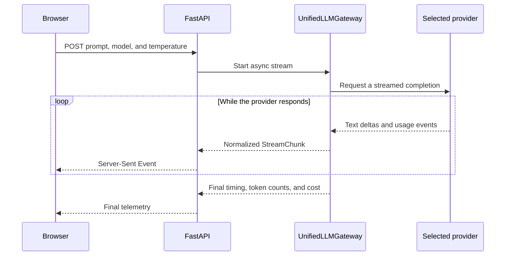

# Multi-Provider Async LLM Gateway

This AD331 project streams text from OpenAI and Anthropic through one Python interface. The FastAPI web page lets you switch providers, adjust temperature, and compare response timing, token usage, and estimated cost.

## Architecture



## Setup

Install Python 3.11+ and [uv](https://docs.astral.sh/uv/getting-started/installation/). For the containerized demo, start Docker Desktop with Docker Compose.

```bash
uv sync --locked
cp -n .env.example .env
```

Edit `.env` locally and set `OPENAI_API_KEY` and `ANTHROPIC_API_KEY` for live calls. `.env` is ignored by Git and excluded from the Docker build. Compose loads it when the container starts. Keep `.env.example` as the placeholder template.

## Run the app and tests

Run directly with Python and open http://127.0.0.1:8000.

```bash
uv run uvicorn src.app:app --host 127.0.0.1 --port 8000
```

For the assignment's local Docker demo, open http://127.0.0.1:8001 after starting Compose.

```bash
docker compose up --build
```

Run the tests from a separate terminal. The tests use simulated provider responses and need no API keys.

```bash
uv run pytest -v
```

Run the same tests inside the running container:

```bash
docker compose exec gateway /app/.venv/bin/python -m pytest -v
```

## Pricing

Standard uncached text rates in USD per million tokens, as configured in `src/pricing.py`.

| Provider | Model | Input | Output |
|---|---|---:|---:|
| OpenAI | `gpt-4o-mini` | $0.15 | $0.60 |
| Anthropic | `claude-haiku-4-5-20251001` | $1.00 | $5.00 |

Sources: [OpenAI GPT-4o mini](https://developers.openai.com/api/docs/models/gpt-4o-mini) and [Anthropic pricing](https://platform.claude.com/docs/en/about-claude/pricing). Haiku 4.5 replaces the retired Claude 3.5 examples in the assignment.

While text is arriving, the browser shows local estimates. At the end, it uses the provider's reported token counts and calculates an estimate at the standard rates above. The calculation uses decimal arithmetic and rounds to six decimal places. Actual billing can differ when cached rates or other pricing rules apply.

## Audit and verification

See [ai_prompt_log.md](ai_prompt_log.md) for the prompt record and the before-and-after diff. The first draft sent telemetry only after the response ended. It also counted the wait for final usage metadata as part of generation time. The revised gateway sends TTFT with the first text and measures generation speed through the last text arrival. Total request time still includes the wait for final usage.

The eight automated checks passed inside Docker. They cover both providers' stream formats using simulated events, a local tokenizer comparison, timing and cost calculations, missing or malformed keys, and safe error messages.
